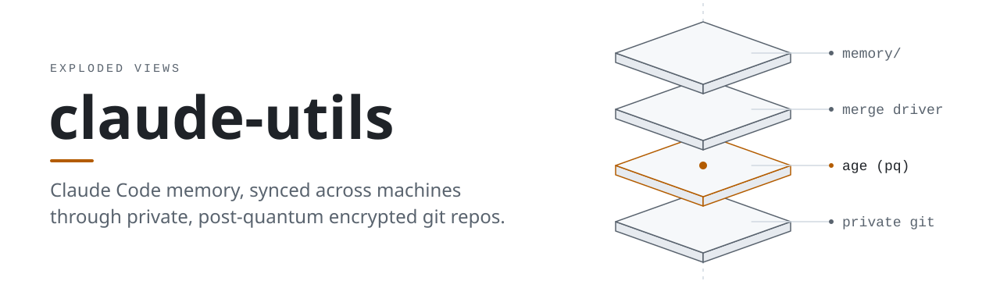
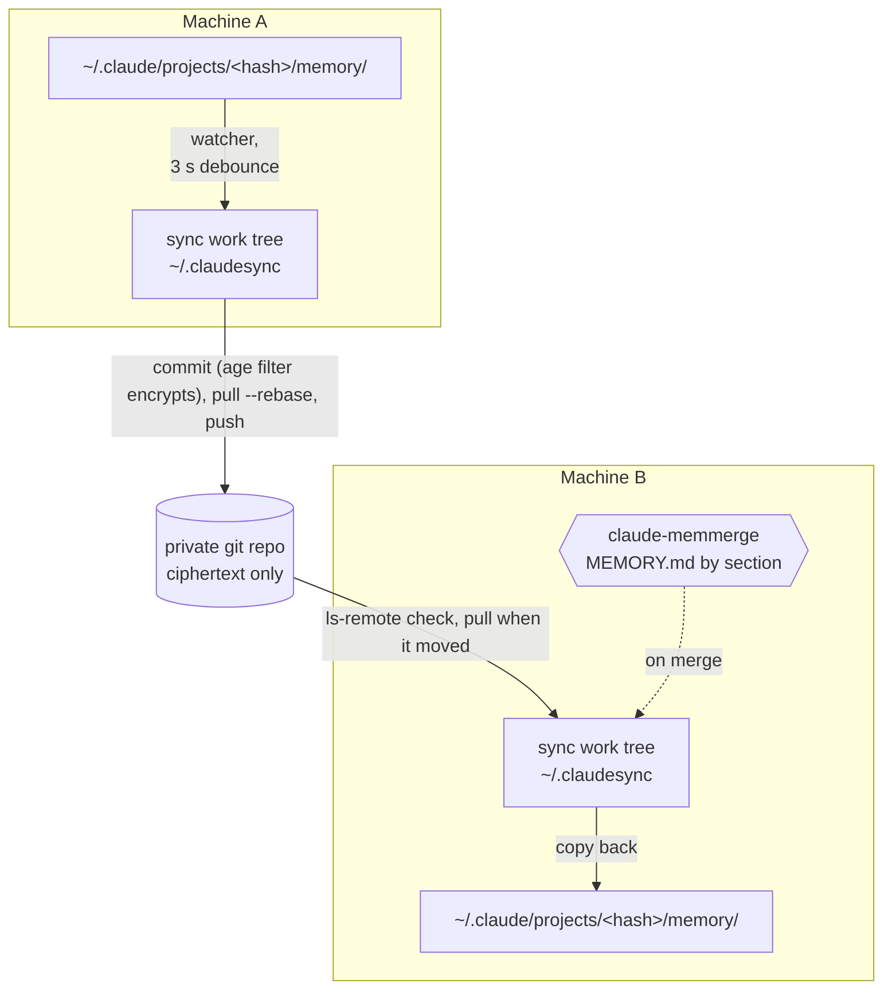
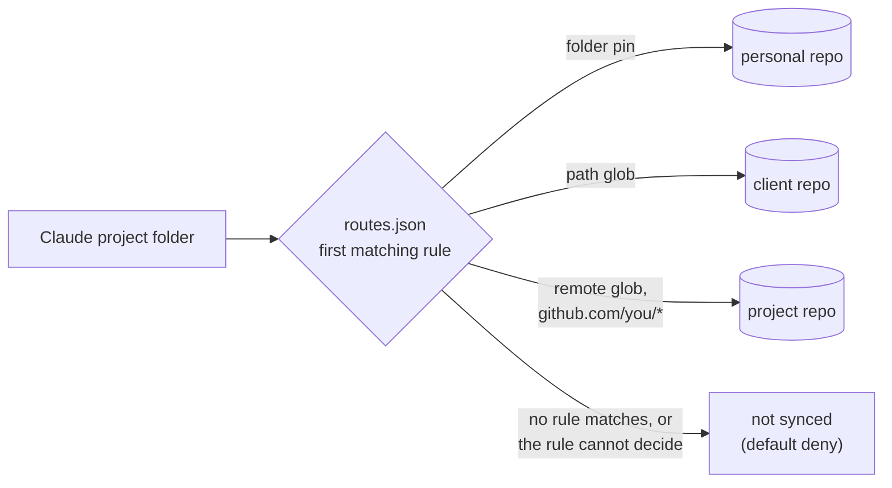

<picture>
  <source media="(prefers-color-scheme: dark)" srcset="docs/assets/memsync-dark.svg">
  
</picture>

# claude-utils (Exploded Views fork)

[](https://github.com/Exploded-views/claude-utils/actions/workflows/fork-ci.yml?query=branch%3Ainteg%2Fnext)
[](https://github.com/Exploded-views/claude-utils/releases)
[](LICENSE)

`claude-memsync` keeps your Claude Code memory in sync across every machine you
work on. It watches `~/.claude/projects/<hash>/memory/`, commits each change to
a private git repo, and pulls what your other machines learned. A custom merge
driver, `claude-memmerge`, merges `MEMORY.md` by section, so two machines that
add notes to the same project end up with both sets instead of a conflict.
It ships as two Go binaries for Linux, macOS and Windows and needs no server.

This fork adds encryption. With `init --encrypt` every note is encrypted
on your machine with [age](https://age-encryption.org) before git sees it, using
hybrid post-quantum keys (ML-KEM-768 + X25519) by default, so the git host
stores only ciphertext. It can also route each project to one of several
private repos, and it adds a reviewed join flow for new machines and a one-pass
bootstrap for new hosts.

This is a fork of [MarimerLLC/claude-utils](https://github.com/MarimerLLC/claude-utils)
by Rockford Lhotka at [Marimer LLC](https://github.com/MarimerLLC). The daemon, the
`MEMORY.md` merge driver, the distill skills and `claude-focus` are his work.

[About this fork](#about-this-fork) · [Install](#install) · [Quickstart](#quickstart) · [How it works](#how-it-works) · [Status](#status) · [Docs](#documentation)

## About this fork

Upstream `claude-utils` syncs one private repo per person, in plain text. That
stops being enough once memory holds things you would not hand to your git
host, or once some notes must never reach some machines. This fork turns
`claude-memsync` into an encrypted, layered memory store for that case. The
model (repo kinds, routing, default deny, the client boundary) and how the
fork tracks upstream are in [docs/fork.md](docs/fork.md); the threat model is
in [docs/security.md](docs/security.md).

The [CHANGELOG](CHANGELOG.md) marks each change *upstream candidate* (useful to
any `claude-memsync` user) or *fork-only* (tied to the layered `mem-*` model).
None has been proposed upstream.

| Change | What it adds | Kind |
|---|---|---|
| Encryption at rest | age clean/smudge filter, a merge driver that decrypts, a pinned recipient set that a person must review before it changes, a pre-push guard that refuses plaintext | Upstream candidate |
| Post-quantum by default | New encrypted repos use hybrid ML-KEM-768 + X25519 keys (`age1pq1...`); classic X25519 only on request; `recipients rekey-pq` converts a classic repo | Upstream candidate |
| Join requests | `join request` on the new host, `join accept` on a member after comparing a fingerprint; nothing is ever accepted automatically | Upstream candidate |
| Several repos per host | `routes.json`: first-match rules by Claude folder, project path or git remote; unmatched folders are not synced | Upstream candidate |
| Secret scrub and denylist | Notes that look like credentials, or match your denylist, stay local and are never committed | Upstream candidate |
| Archive, never delete | `--archive-deletes` moves deleted notes to `archive/<date>/`; `archive list` and `archive search` | Upstream candidate |
| Session notices | `changes --hook` tells a running Claude Code session which notes changed on another machine | Upstream candidate |
| Safer operation | Foreign-writer guard, GitHub App and token-command auth, renamed-remote aliases, pinned releases with `SHA256SUMS` | Upstream candidate |
| Layered `mem-*` repos | Repo kinds (personal, project, infra, client, orchestrator), home-folder routing, a client boundary that routing cannot cross by accident | Fork-only |
| Private repos only | `mem-*` name allowlist, visibility verified at creation and re-checked hourly, `doctor` with a daily timer | Fork-only |
| Related projects | Read-only copies of related repos and a session-start index, with suggestions from this host's own history | Fork-only |
| Host lifecycle | Host labels on keys, `host list`, `host retire`, read-only members, expiry dates | Fork-only |
| Host bootstrap | `scripts/bootstrap.sh`: repos, deploy keys, routes, init and join requests in one pass, dry run first, or as one paste prompt | Fork-only |
| Fork CI | Race tests, per-package coverage floors that only rise, shellcheck and macOS portability lints, gitleaks, a release-layout test | Fork-only |

`main` mirrors upstream's `main`. The fork's work and its release tags are on
`integ/next`, so build from that branch.

## Install

You need `git` 2.26 or later on `PATH` at runtime. `claude-memsync` and
`claude-memmerge` must sit in the same directory, because the daemon finds the
merge driver next to itself. The steps below put both in `~/.local/bin`, which
must be on your `PATH`.

### From a release

Each [release](https://github.com/Exploded-views/claude-utils/releases) has an
archive per platform (`linux`, `darwin` and `windows`, each `amd64` and `arm64`)
and a `SHA256SUMS` file. The current one, `v0.4.0-ev.1`, is a pre-release. On
Linux or macOS:

```sh
TAG=v0.4.0-ev.1
PLATFORM=linux-amd64        # linux-arm64, darwin-amd64 or darwin-arm64
NAME=claude-utils-$TAG-$PLATFORM
URL=https://github.com/Exploded-views/claude-utils/releases/download/$TAG
curl -fLO "$URL/$NAME.tar.gz" -O "$URL/SHA256SUMS"
sha256sum -c --ignore-missing SHA256SUMS     # macOS: grep " $NAME.tar.gz\$" SHA256SUMS | shasum -a 256 -c -
tar -xzf "$NAME.tar.gz"
mkdir -p ~/.local/bin && cp "$NAME/claude-memsync" "$NAME/claude-memmerge" ~/.local/bin/
claude-memsync version      # claude-memsync v0.4.0-ev.1
```

Do not extract an archive that does not verify. On Windows, unzip
`claude-utils-<tag>-windows-<arch>.zip` and keep `claude-memsync.exe` and
`claude-memmerge.exe` in one folder. Each archive also carries
`scripts/bootstrap.sh`, so a verified download can set up a full host with no
clone and no Go ([docs/releases.md](docs/releases.md)).

### From source

Go 1.25 or later:

```sh
git clone -b integ/next https://github.com/Exploded-views/claude-utils.git
cd claude-utils
go build -o ~/.local/bin/ ./cmd/claude-memsync ./cmd/claude-memmerge
```

## Quickstart

Two machines sharing one encrypted repo. Any empty private git repo works as
the remote. For a recovery key, `age-keygen -pq` (age 1.3 or later) makes one;
keep the private half offline and pass the public `age1pq1...` key.

On the first machine:

```sh
gh repo create <you>/<repo> --private
claude-memsync init --remote git@github.com:<you>/<repo>.git --encrypt \
  --host-label laptop --recovery-recipient <age1pq1-recovery-public-key>
claude-memsync install      # systemd user unit, launchd agent, or Windows Startup script
claude-memsync start
claude-memsync status
```

`init --encrypt` creates this host's post-quantum identity in
`${XDG_CONFIG_HOME:-~/.config}/claude-memsync/` (mode 0600, never printed), copies your existing
memory into the sync repo, and pushes it encrypted. Back the identity up:
without it, or the recovery key, the notes cannot be read.

On the second machine, after installing the binaries:

```sh
claude-memsync init --remote git@github.com:<you>/<repo>.git --encrypt --host-label desktop
claude-memsync join request --label desktop      # prints a fingerprint
```

The new host is keyless: it syncs nothing until a member adds its key. On the
first machine, compare the fingerprint over a channel you trust, then accept:

```sh
claude-memsync join list
claude-memsync join accept desktop --fingerprint "<fingerprint>"
```

Back on the second machine, start the daemon, check the key set it pulled, and
accept it only if every key is one you expect:

```sh
claude-memsync install && claude-memsync start
claude-memsync join status          # compare with `recipients list` on the first machine
claude-memsync recipients accept --yes
```

From then on both machines sync on their own. Leave out `--encrypt` for
upstream's plain-text behaviour; the steps then end at `install` and `start` on
each machine.

For several repos per host, a GitHub org with private-only checks, and the
one-prompt bootstrap, follow [docs/setup.md](docs/setup.md) and
[docs/bootstrap.md](docs/bootstrap.md). Every command and flag is in
[docs/reference.md](docs/reference.md).

## How it works



- The watcher copies each change from Claude's memory folder into the sync work
  tree, commits, rebases onto the remote and pushes. An idle tick costs one
  `git ls-remote`; a full pull runs only when the remote moved.
- In an encrypted repo a git clean/smudge filter encrypts on `git add` and
  decrypts on checkout, so both memory folders stay plain text and the remote
  holds only age ciphertext. Before every push the daemon checks each outgoing
  blob is ciphertext and refuses the push otherwise.
- When both machines changed `MEMORY.md`, `claude-memmerge` unions the section
  blocks. Conflict markers never reach `~/.claude`. Only `MEMORY.md` is
  merged: when another note differs on both sides, your Claude copy is kept and
  the remote copy is saved in the sync work tree as `<name>.from-remote-<random>`.
- File names, sizes, commit times and the recipients' public keys stay visible
  to the git host. [docs/security.md](docs/security.md) lists what is and is
  not protected.

With a `routes.json`, one daemon runs a sync loop per repo and each Claude
project folder goes to exactly one of them. The first matching rule wins:



A rule that cannot decide (the checkout is missing, or has no readable
`origin`) denies the folder on the spot instead of falling through to a broader
rule. Details are in [docs/claude-memsync.md](docs/claude-memsync.md#several-repos-per-host).

## Distill skills and claude-focus

Both come from upstream unchanged.

- **[Distilling memories](docs/distilling-memories.md).** The `/distill` and
  `/distill-apply` Claude Code skills lift transferable lessons (shell and OS
  quirks, CLI gotchas, your standing preferences) out of one project into a
  shared catalog and apply them to any other project. `claude-memsync distill`
  rebuilds the catalog index.
- **[claude-focus](docs/claude-focus.md).** A small Windows helper that brings
  the Claude desktop app to the front, launching it if needed. Bind it to the
  Copilot key with PowerToys and that key opens Claude.

## Status

Pre-release and pre-1.0: config format and on-disk layout can still change.
`v0.4.0-ev.1` is the fork's current release; it adds `join --all`, `identity
backup` and faster host bootstrap, and fixes autostart (in `v0.3.0-ev.1` the
Linux systemd user unit does not start after a reboot and the macOS launchd
agent does not start at login; the
[CHANGELOG](CHANGELOG.md#v040-ev1-2026-10-27) says how to upgrade each).
Each release's changes are in the [CHANGELOG](CHANGELOG.md). Open work is in
[docs/fork.md](docs/fork.md#known-follow-ups) and the
[issues](https://github.com/Exploded-views/claude-utils/issues).

## Related projects

- **[crewkit](https://github.com/Exploded-views/crewkit)**: agent practice,
  memory notices and crew tooling for Claude Code. Its installer fetches a
  pinned release of this fork's `claude-memsync` and checks its sha256.
- **[bitc](https://github.com/Exploded-views/bitc)**: offloads heavy commands
  to pluggable cloud providers under a spend cap, falling back to local slots.

## Documentation

| Doc | What it covers |
|---|---|
| [docs/claude-memsync.md](docs/claude-memsync.md) | The daemon in depth: lifecycle, what syncs, scrub, deletes, routing, encryption, joins, host lifecycle |
| [docs/fork.md](docs/fork.md) | The fork's layered model: repo kinds, routing, default deny, client boundary |
| [docs/setup.md](docs/setup.md) | From nothing to several machines sharing encrypted, layered memory |
| [docs/bootstrap.md](docs/bootstrap.md) | `scripts/bootstrap.sh`, its exit codes and the paste prompts |
| [docs/security.md](docs/security.md) | Threat model, keys, what the git host sees, recovery |
| [docs/releases.md](docs/releases.md) | Installing and upgrading from a release, and cutting one |
| [docs/reference.md](docs/reference.md) | Every command and flag, generated from `--help` |
| [docs/ci.md](docs/ci.md) | Fork CI, the coverage ratchet and the guards |
| [docs/distilling-memories.md](docs/distilling-memories.md), [docs/claude-focus.md](docs/claude-focus.md) | The upstream tools |

## Project layout

| Path | Purpose |
|---|---|
| `cmd/claude-memsync` | Daemon binary: lifecycle, watcher, sync loop, and the fork's subcommands |
| `cmd/claude-memmerge` | Git custom merge driver for `MEMORY.md` |
| `cmd/claude-focus` | Windows only: focus or launch the Claude desktop app from a hotkey |
| `internal/sync` | Mirror, reconcile, watcher loop, manifest |
| `internal/merge` | Section-block parser and 3-way semantic merge |
| `internal/distill` | Distilled-memory catalog index and reconcile |
| `internal/gitwt` | Wrapper around the `git` CLI scoped to the sync work tree |
| `internal/config` | Config load and save (`~/.claudesync/config.json`) |
| `internal/proc` | Hides child-process console windows on Windows |
| `internal/version` | Version from an `-ldflags` override or embedded VCS info |
| `internal/agecrypt`, `internal/route`, `internal/scrub`, ... | Fork additions; the full list is in [docs/fork.md](docs/fork.md#fork-only-parts-of-the-tree) |
| `skills/` | `/distill` and `/distill-apply` Claude Code skills |
| `plugins/memory-notices` | Claude Code plugin: memory index at session start, changed-note notices |
| `scripts/` | Host bootstrap, release packaging, CI lints and their tests |
| `.githooks/` | Shared git hooks (pre-commit gofmt check) |

## Development

A pre-commit hook runs the same `gofmt` check as CI. Enable it once per
clone:

```sh
git config core.hooksPath .githooks
```

It checks staged `.go` files only and prints the `gofmt -w` command that fixes
them. `go vet`, the race
tests and the coverage floors run in CI ([docs/ci.md](docs/ci.md)); run the
same coverage check locally with `make cover cover-check`.

## Releasing

Versions follow [SemVer](https://semver.org); the fork's own releases carry an
`-ev.N` suffix. Publishing a GitHub Release runs `.github/workflows/release.yml`,
which builds the archives and `SHA256SUMS`. The version rules and the steps are
in [docs/releases.md](docs/releases.md#cutting-a-release).

## License

MIT, copyright Marimer LLC. See [LICENSE](LICENSE).
